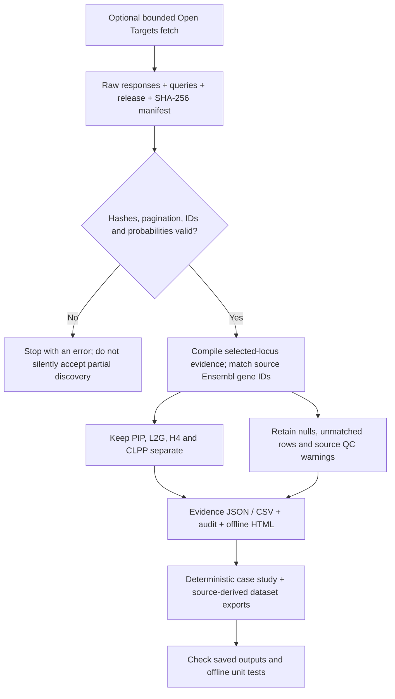

# How the evidence explorer works

The pipeline retrieves and audits existing public aggregate evidence. It trains no model and makes no causal-gene selection.

The checked-in snapshot is sufficient for the offline path. A new fetch is optional and uses a new directory. Endpoint-level partial evidence is labeled; incomplete study discovery fails. Returned records describe availability, not evidence strength.

| Stage | Read the implementation | Why it matters |
|---|---|---|
| Bounded collection | `fetch_snapshot`, `merge_pages` in [gwas_explorer.py](gwas_explorer.py) | Preserve request provenance and detect changed page counts or duplicate records. |
| Integrity and compilation | `compile_evidence`, `probability`, `quality_controls` in [gwas_explorer.py](gwas_explorer.py) | Reject invalid values while retaining source warnings and missingness. |
| Reports | `build` in [gwas_explorer.py](gwas_explorer.py), [HTML template](explorer_template.html) | Make the same saved evidence inspectable without an external service. |
| Case study and export | [Case-study builder](analysis/build_case_study.py), [dataset exporter](analysis/export_real_dataset.py) | Match source identifiers and check generated artifacts deterministically. |
| Verification | [Offline tests](tests), [snapshot manifest](data/manifest.json) | Test software and source integrity; do not infer biological validation. |

The nearest returned candidate is limited to the filtered L2G response. The upstream scores can share inputs, so showing them together does not make them independent or turn them into a combined posterior. See the [evidence boundaries](README.md#evidence-boundaries).
